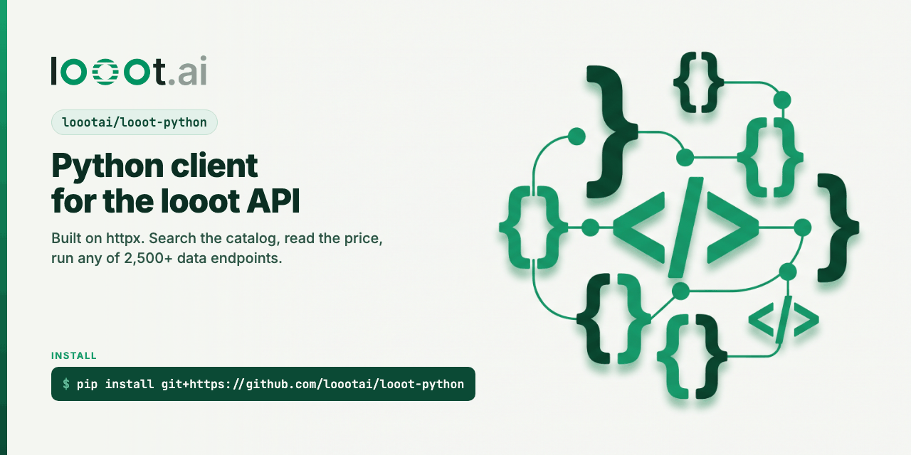

<p align="center"></p>

# looot for Python

[](https://pypi.org/project/looot/) [](LICENSE) [](https://docs.looot.ai)

The official Python client for [looot](https://looot.ai). looot puts 4,200+ tools across 300+
providers behind one key and one prepaid balance: find and verify emails, enrich companies,
pull SERP and SEO data, scrape pages, read social profiles. You see the price before every
call, and a failed call costs nothing.

This client gives you `Looot` (sync) and `AsyncLooot` (asyncio) with the same methods, typed
responses, retries on the errors that are safe to retry, and idempotency keys on every run.

## Install

```bash
pip install looot
```

Python 3.10 or newer. One dependency, `httpx`. Until the first PyPI release is out, install
from GitHub: `pip install git+https://github.com/loootai/looot-python`.

## Quickstart

Create an agent token at [looot.ai](https://looot.ai) and export it as `LOOOT_TOKEN`. Then find
a work email, checking the balance first:

```python
from looot import Looot

with Looot() as looot:                                  # reads LOOOT_TOKEN
    balance = looot.balance()
    if balance["available"] < 0.10:
        raise SystemExit(f"Top up first: {balance['topUpLink']['dashboardUrl']}")
    run = looot.run_job(
        "people.email.find",
        {"first_name": "Jane", "last_name": "Doe", "domain": "example.com"},
        fallback=True,
        wait=30,
    )
    print(run["status"], run.get("outcome"), run.get("result"), run.get("actualCost"))
```

The job takes `first_name`, `last_name` and `domain`, or a `linkedin_url`. The `search` answer's
`jobInputs` lists the input names each job accepts. `fallback=True` lets looot try the next
provider when one misses. A returned run is not
success on its own: read `status`, `outcome` and `error`. A miss is a normal answer.

Browsing the catalog is free and needs no token:

```python
with Looot() as looot:
    for job in looot.catalog_overview(topic="email")["jobs"]:
        print(job["id"], job["providerCount"], job["cheapestPerCall"])
```

The same thing with asyncio:

```python
import asyncio
from looot import AsyncLooot

async def main():
    async with AsyncLooot() as looot:
        found = await looot.search("verify an email", prefer="cheapest", limit=3)
        print([row["endpointId"] for row in found["endpoints"]])

asyncio.run(main())
```

## Methods

Every method exists on `Looot` and, as a coroutine, on `AsyncLooot`.

| Method | Route | Token scope | Cost |
| --- | --- | --- | --- |
| `catalog_overview(depth=, category=, platform=, topic=)` | `GET /v1/catalog/overview` | none | free |
| `public_catalog(q=, text=, capability=, category=, provider=, operation_id=, limit=, cursor=)` | `GET /v1/public-catalog` | none | free |
| `public_catalog_item(catalog_item_id)` | `GET /v1/public-catalog/{id}` | none | free |
| `compare_public_catalog(catalog_item_ids)` | `POST /v1/public-catalog/compare` | none | free |
| `search(q, limit=, offset=, capability=, prefer=, max_price_micros=, keyless=, ...)` | `GET /v1/catalog/search` | `catalog.read` | free |
| `discover(query, prefer=, capability=, result_limit=, ...)` | `GET /v1/discover` | `catalog.read` | free |
| `catalog_endpoints(limit=, cursor=, facets=, ...)` | `GET /v1/catalog/endpoints` | `catalog.read` | free |
| `inspect(endpoint_id)` | `GET /v1/operations/{id}` | any | free |
| `run(endpoint_id, input, idempotency_key=, wait=, fallback=, output=)` | `POST /v1/runs` | `runs.execute` | paid |
| `run_job(job, input, prefer=, fallback=, wait=, idempotency_key=, output=)` | `POST /v1/runs` with `job:<id>` | `runs.execute` | paid |
| `get_run(run_id, fields=, max_items=)` | `GET /v1/runs/{id}` | `runs.read` | free |
| `wait_for_run(run_id, timeout=, interval=)` | polls `GET /v1/runs/{id}` | `runs.read` | free |
| `list_runs(status=, capability=, limit=, cursor=, include_result=)` | `GET /v1/runs` | `runs.read` | free |
| `cancel_run(run_id)` | `POST /v1/runs/{id}/cancel` | `runs.execute` | free |
| `run_attempts(run_id)` | `GET /v1/runs/{id}/attempts` | `runs.read` | free |
| `download_media(download_path)` | `GET <result.media.downloadPath>` | any | free |
| `balance()` | `GET /v1/balance` | `usage.read` | free |
| `list_top_ups()` | `GET /v1/top-ups` | `usage.read` | free |
| `ledger(limit=, cursor=)` | `GET /v1/ledger` | `usage.read` | free |
| `whoami()` | `GET /v1/whoami` | `organizations.read` | free |
| `capability_request(title, description, desired_inputs=, desired_outputs=)` | `POST /v1/capability-requests` | any | free |
| `iter_runs()`, `iter_public_catalog()`, `iter_search()` | follow the cursor or offset | as above | free |

Arguments are snake_case. The client sends them in the API's camelCase (`max_price_micros`
goes out as `maxPriceMicros`) and drops every argument left as `None`. Path ids are
percent-encoded, so `job:people.email.find` or an id with a slash stays one segment.

Responses are typed `TypedDict`s (`Run`, `Balance`, `SearchResult` and the rest). At runtime
they are plain dicts, so a field the API adds later is there without an SDK release.

## Runs, jobs and idempotency

- `run_job("people.email.find", input)` sends `endpointId: "job:people.email.find"` and looot
  picks the provider. Take job ids from `catalog_overview(topic=...)` or a search row's
  `capability`. Never make one up.
- `prefer="cheapest"` goes into `fallback.prefer` and turns fallback on. With neither `prefer`
  nor `fallback`, a job run does not fall back.
- `wait=30` holds the request up to 30 seconds (0 to 60). Without it the run comes back
  `queued`. Use `wait_for_run(run_id)` to poll until it settles.
- Every run carries an idempotency key. The client makes one (`sdk-<uuid>`) when you pass
  none. Build your own from your record (`lead-4821-email`) so a crashed worker replays the
  first run instead of paying twice.
- A pre-dispatch refusal (unknown job, bad input) comes back as a run with
  `status == "failed"`, not as an exception. It costs $0.

## Errors and retries

Every non-2xx answer raises `LoootError`:

```python
from looot import Looot, LoootError

try:
    run = looot.run_job("people.email.verify", {"email": "jane.doe@example.com"}, fallback=True)
except LoootError as e:
    print(e.status, e.code, e.request_id, e.retryable, e.retry_hint)
    if e.code == "insufficient_balance":
        print("Top up at", e.top_up.url)
```

| Field | Meaning |
| --- | --- |
| `status` | HTTP status, or 0 for a network failure or timeout |
| `code` | the API's error code, such as `insufficient_balance` or `http_502` |
| `message`, `request_id` | the API's message and request id |
| `retryable` | True when the same request may succeed later |
| `retry_hint` | one sentence on what to do next |
| `retry_after_seconds` | how long the API asked you to wait |
| `top_up` | on a 402: `checkout_url`, `dashboard_url`, and `url` (whichever is set) |
| `body` | the decoded response body |

The client retries 429s, the retryable 503s, one 500, network failures and timeouts, at most
2 times by default. It waits `retry_after_seconds` (capped at 30 s) or backs off from 0.5 s,
and it reuses the same idempotency key, so a retried run is never charged twice. It never
retries any other 4xx. Pass `max_retries=0` to turn retries off.

A run that failed is a 2xx answer, not an exception. Its `error` has `code`, `whoseError`,
`retryable` and `retryHint`. To try again, start a new run with a new idempotency key: the
same key only replays the settled failure.

## Configuration

```python
Looot(
    token=None,                      # else LOOOT_TOKEN, else LOOOT_API_KEY
    base_url="https://api.looot.ai",
    timeout=75.0,                    # seconds per request, enough for wait=60
    max_retries=2,
    agent="my-app",                  # sent as X-Looot-Agent, for usage analytics only
    transport=None,                  # an httpx transport, for tests
)
```

Every request sends `User-Agent: looot-python/<version> python/<version>`. The free catalog
routes never send your token, even when one is set. The token never shows up in a `repr`, an
error message or a log line from this client.

## Examples

```bash
python examples/overview.py                                    # free, no token
LOOOT_TOKEN=... python examples/search_and_inspect.py          # free, token
LOOOT_TOKEN=... python examples/runs_and_balance.py            # free, token
LOOOT_TOKEN=... python examples/async_search.py                # free, token
LOOOT_TOKEN=... python examples/run_job_with_fallback.py Jane Doe example.com   # paid
```

## Develop

```bash
python3 -m venv .venv
.venv/bin/pip install -r requirements-dev.lock   # exact pins of the dev tree
.venv/bin/pip install --no-deps -e .
.venv/bin/pytest                                 # offline, mocked HTTP
.venv/bin/pytest -m live                         # free public routes only
python scripts/gen_async.py                      # after any change to _client.py
bash scripts/leak-scan.sh .
```

`src/looot/_async_client.py` is generated from `src/looot/_client.py`. Edit the sync client,
then run the generator. A test fails when the two drift apart. Releases: see
[PUBLISH.md](PUBLISH.md).

## Links

- Docs: https://docs.looot.ai
- API reference: https://docs.looot.ai/reference
- Run errors: https://docs.looot.ai/errors/run-errors
- Agent guide: https://looot.ai/skill.md
- MCP server: `claude mcp add --transport http looot https://api.looot.ai/mcp`
- TypeScript SDK: https://github.com/loootai/looot-js

## License

MIT. See [LICENSE](LICENSE).
